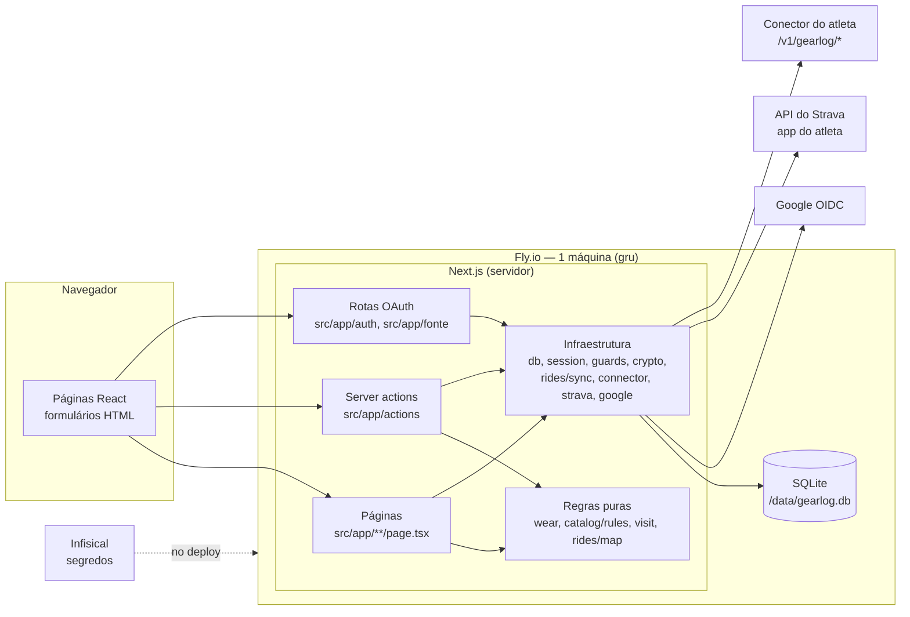

# Arquitetura — GearLog (Fase 1)

Documento de arquitetura consolidado: visão, drivers, decisões técnicas, descrição em camadas e justificativas. As decisões que amarram o projeto estão nos [ADRs](adr/). A revisão multidimensional está em [docs/review/](review/).

## 1. Visão arquitetural

O GearLog é um **monólito web** em Next.js (App Router) com banco SQLite, publicado numa única máquina do Fly.io. O navegador fala só com o servidor do GearLog. Ele, por sua vez, fala com o Google (login), com o Strava (pela API do app do próprio atleta) ou com o conector do atleta.

## 2. Drivers arquiteturais

Os requisitos e restrições que mais mudaram a estrutura:

| Driver | Origem | Efeito na arquitetura |
|---|---|---|
| Desgaste consistente mesmo quando um pedal é editado, apagado ou chega de novo | RF06, RF07, RB02 | Pedais guardados e desgaste calculado na leitura, sem contador ([ADR-007](adr/ADR-007-desgaste-calculado-dos-pedais.md)) |
| Regra de desgaste testável sem banco e sem UI | RNF08 | Módulo puro `src/lib/wear.ts`, testado com Vitest |
| Strava com um app por conta e limite de 100 leituras a cada 15 min | RNF05, RB08 | Três fontes de pedais: manual, app próprio do atleta, conector ([ADR-006](adr/ADR-006-fontes-de-pedais.md)) |
| Strava fora do ar não pode travar o app; a demo roda sem Strava | RNF06, regra da disciplina | Pedais guardados localmente; lançamento manual sempre disponível |
| Dois perfis com permissões diferentes | Regra da disciplina, RB17 | Login único pelo Google ([ADR-005](adr/ADR-005-login-unico-google.md)); admin por lista de e-mails conferida a cada requisição ([ADR-002](adr/ADR-002-autenticacao.md)) |
| Tokens e chaves de terceiros | RNF01 | Criptografia AES-256-GCM no banco; segredos do servidor no Infisical ([ADR-003](adr/ADR-003-segredos-infisical.md)) |
| Projeto individual, prazo curto, custo zero | Restrição | Monólito, SQLite num volume, uma máquina no Fly ([ADR-001](adr/ADR-001-stack.md), [ADR-004](adr/ADR-004-deploy-fly.md)) |

## 3. Decisões técnicas

| Decisão | Registro | Reversibilidade |
|---|---|---|
| TypeScript, Next.js 16, Prisma 7 + SQLite, Vitest | [ADR-001](adr/ADR-001-stack.md) | Baixa: trocar exige reescrever camadas |
| Admin pelo Google com lista de e-mails | [ADR-002](adr/ADR-002-autenticacao.md) | Média |
| Segredos no Infisical, entregues ao Fly no deploy | [ADR-003](adr/ADR-003-segredos-infisical.md) | Alta |
| Fly.io, uma máquina, volume para o SQLite, domínio próprio | [ADR-004](adr/ADR-004-deploy-fly.md) | Média |
| Todos entram pelo Google; sem senhas | [ADR-005](adr/ADR-005-login-unico-google.md) | Média |
| Fonte de pedais por atleta: manual, Strava próprio ou conector | [ADR-006](adr/ADR-006-fontes-de-pedais.md) | Baixa |
| Desgaste calculado dos pedais guardados | [ADR-007](adr/ADR-007-desgaste-calculado-dos-pedais.md) | Baixa |
| Catálogo vem da planilha (`seed.json`), carregado na primeira subida | RF30, `src/instrumentation.ts` | Alta (decisão barata, sem ADR) |
| Server actions + formulários HTML, sem API REST própria | Convenção do Next.js | Alta (sem ADR) |

> A disciplina pede de 3 a 5 ADRs e o projeto tem 7. O ADR-002 foi em parte substituído pelo ADR-005. Se o professor exigir no máximo 5, o caminho é fundir o ADR-002 no ADR-005 e o ADR-003 no ADR-004 (OPEN-19).

## 4. Camadas e responsabilidades

| Camada | Onde | Faz | Não faz |
|---|---|---|---|
| Apresentação | `src/app/**/page.tsx`, `src/components/` | Lê o modelo de leitura e desenha a tela; formulários HTML | Regra de negócio, acesso direto a segredos |
| Aplicação | `src/app/actions/*.ts` (server actions), `src/app/auth/**`, `src/app/fonte/**` | Autoriza, valida entrada, orquestra regras e grava numa transação | Cálculo de desgaste |
| Domínio (puro) | `src/lib/wear.ts`, `src/lib/catalog/rules.ts`, `src/lib/visit.ts`, `src/lib/rides/map.ts`, `src/lib/dates.ts` | Regras e invariantes (RB02–RB18), sem banco e sem UI | I/O |
| Infraestrutura | `src/lib/db.ts`, `session.ts`, `guards.ts`, `crypto.ts`, `rides/sync.ts`, `connector/`, `strava/`, `google/` | Banco, sessão, criptografia, HTTP com Google, Strava e conector | Decidir regra de negócio |
| Leitura | `src/lib/tracker.ts` | Junta dados do banco e aplica as regras puras para as telas | Gravar |

Atributos que a disciplina cobra:

- **Regra de negócio fora do controller:** as server actions chamam `wear`, `catalog/rules` e `visit`; o cálculo de desgaste só existe em `wear.ts`.
- **Persistência não vaza para o domínio:** os módulos puros recebem objetos simples (`WearPart`, `WearPlan`, `WearRide`) e não importam o Prisma.
- **Regra de domínio roda sem banco e sem UI:** `tests/unit/wear.test.ts`, `catalog.test.ts` e `visit.test.ts` rodam só com Node.
- **Onde fica a autorização:** toda server action começa com `requireUser()` ou `requireAdmin()` (`src/lib/guards.ts`). Toda consulta filtra pelo dono (`userId` da sessão). O admin é conferido a cada requisição contra `ADMIN_EMAILS` (`getCurrentAdmin`, RB17).

## 5. Dados

- **Modelo:** [dominio.md](dominio.md) (conceitual) e [uml.md](uml.md) (classes). Esquema físico em `prisma/schema.prisma`, migrações versionadas em `prisma/migrations/`, aplicadas no início do contêiner (`prisma migrate deploy`).
- **Volume:** SQLite em `/data/gearlog.db`, volume `gearlog_data` do Fly. Uma máquina só, porque o SQLite não é compartilhado.
- **Minimização (LGPD):** do Strava guardamos só id, bike, tipo, data, distância e tempo em movimento. Nada de GPS, frequência cardíaca, potência ou fotos.

## 6. Integrações

| Integração | Protocolo | Falha |
|---|---|---|
| Google | OpenID Connect com PKCE, `state` e `nonce` | Login recusado; sem sessão |
| Strava (app do atleta) | OAuth 2.0; `GET /athlete/activities`, `GET /athlete`; refresh automático do token | Erro registrado (RF13); dados mantidos |
| Conector do atleta | HTTPS com `Authorization: Bearer`; `/v1/gearlog/status`, `/bikes`, `/activities?since=` | Idem; URL validada contra SSRF |

O contrato do conector está em [integracao-strava.md](integracao-strava.md) e foi conferido contra o código do conector em 13/11/2026.

## 7. Implantação

- GitHub Actions (`.github/workflows/`): o CI roda testes, lint e tipos em todo PR; o deploy roda os mesmos testes e só então publica.
- O deploy entra no Infisical por OIDC, entrega os segredos ao Fly e roda `flyctl deploy`. Só o `FLY_API_TOKEN` fica nos secrets do GitHub.
- Domínio: `gearlog.jopucci.com` (Cloudflare, só DNS). `*.fly.dev` redireciona para o domínio.
