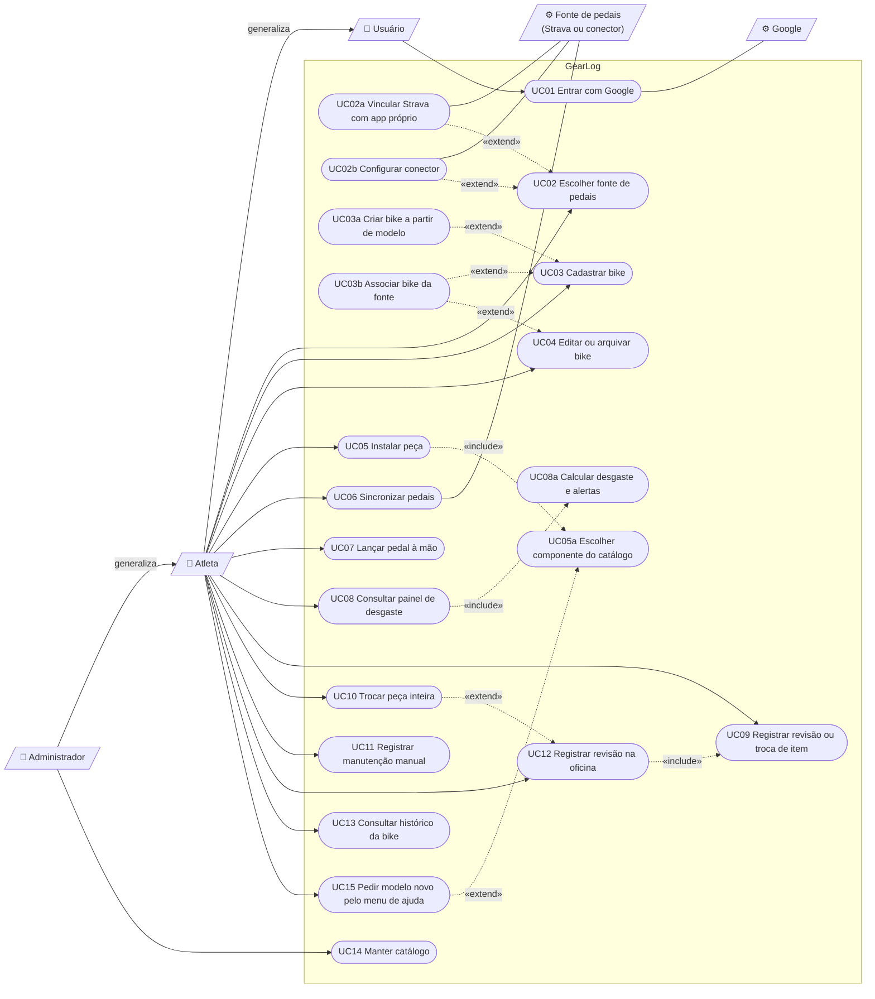

# Casos de Uso — GearLog (Fase 1)

Casos de uso da Fase 1, a entrega da disciplina. Cada caso aponta para os requisitos de [requisitos.md](requisitos.md). Os termos estão no [glossário](glossario.md). As Fases 2 e 3 ficam só em [segundo-estagio.md](segundo-estagio.md).

## Atores

| Ator | Tipo | Descrição |
|---|---|---|
| Usuário | Principal (abstrato) | Quem entra com a conta Google. Especializa-se em Atleta ou Administrador. |
| Atleta | Principal | Ciclista dono das bikes. Persona: Rafael ([personas.md](personas.md)). |
| Administrador | Principal | Mantém o catálogo. Também pode ter bikes, por isso herda os casos do Atleta. Persona: Beatriz. |
| Google | Secundário (sistema) | Provedor de identidade (OpenID Connect, [ADR-005](adr/ADR-005-login-unico-google.md)). |
| Fonte de pedais | Secundário (sistema) | Strava (com o app do próprio atleta) ou o conector do atleta ([ADR-006](adr/ADR-006-fontes-de-pedais.md)). |

## Diagrama

O Mermaid não tem diagrama de casos de uso nativo. O diagrama abaixo usa um fluxograma: atores são retângulos, casos de uso são elipses, a seta cheia liga o ator ao caso, `«include»` e `«extend»` aparecem como setas tracejadas e a generalização aparece como seta com triângulo.

## Rastreabilidade

| Caso de uso | Requisitos | Regras | Situação |
|---|---|---|---|
| UC01 Entrar com Google | RF04, RNF02 | RB17 | Feito |
| UC02 Escolher fonte de pedais | RF32 | RB08 | Feito |
| UC02a Vincular Strava com app próprio | RF33, RNF01, RNF05 | RB08 | Feito |
| UC02b Configurar conector | RF34, RNF01 | RB08 | Feito |
| UC03 Cadastrar bike | RF01 | — | Feito |
| UC03a Criar bike a partir de modelo | RF35 | RB15, RB16 | Feito |
| UC03b Associar bike da fonte | RF05 | RB02 | Feito |
| UC04 Editar ou arquivar bike | RF01 | RB02, RB05 | Feito |
| UC05 Instalar peça | RF02, RF03 | RB01, RB10, RB15, RB16 | Feito |
| UC06 Sincronizar pedais | RF05, RF06, RF13, RNF05, RNF06 | RB02, RB03, RB12 | Feito (manual) |
| UC07 Lançar pedal à mão | RF14 | RB03 | Feito |
| UC08 Consultar painel de desgaste | RF07, RF08, RF09, RF15 | RB04, RB11, RB14 | Feito |
| UC09 Registrar revisão ou troca de item | RF10, RF11 | RB13, RB16, RB18 | Feito |
| UC10 Trocar peça inteira | RF10 | RB01, RB05 | Feito |
| UC11 Registrar manutenção manual | RF12 | — | Feito |
| UC12 Registrar revisão na oficina | RF36 | RB13, RB18 | Feito |
| UC13 Consultar histórico da bike | RF11 | RB05 | Feito |
| UC14 Manter catálogo | RF30, RF35 | RB10, RB15, RB17 | Feito |
| UC15 Pedir modelo novo pelo menu de ajuda | RF31 | RB15 | Pendente |

## Descrições

Formato: ator, pré-condições, fluxo principal (FP), fluxos alternativos (FA) e de exceção (FE), pós-condições.

### UC01 — Entrar com Google

- **Ator:** Usuário. **Secundário:** Google.
- **Pré:** nenhuma.
- **FP:** 1. O usuário clica em "Entrar com Google". 2. O sistema redireciona para o Google com `state`, `nonce` e PKCE. 3. O Google devolve o código. 4. O sistema troca o código, valida o ID token e exige e-mail verificado. 5. O sistema cria ou localiza o usuário: Administrador se o e-mail está em `ADMIN_EMAILS` (RB17), Atleta nos demais casos. 6. O sistema abre a sessão (cookie com token aleatório; o banco guarda só o hash).
- **FE1:** `state` diferente, login cancelado ou e-mail não verificado → volta à página inicial com erro, sem sessão.
- **Pós:** sessão aberta por 30 dias. Ao acessar `/admin`, a permissão é conferida de novo a cada requisição.

### UC02 — Escolher fonte de pedais

- **Ator:** Atleta.
- **Pré:** sessão aberta.
- **FP:** 1. O atleta abre "Fonte". 2. Escolhe manual, Strava (app próprio) ou conector. 3. O sistema grava a escolha.
- **FA1 (UC02a):** escolheu Strava → o sistema mostra o tutorial, recebe `Client ID` e `Client Secret`, guarda o secret criptografado e faz o OAuth com os escopos `read`, `profile:read_all` e `activity:read_all`.
- **FA2 (UC02b):** escolheu conector → o sistema recebe URL e chave, recusa URL sem `https` ou que aponte para rede privada (SSRF), testa `/v1/gearlog/status` e guarda a chave criptografada.
- **FE1:** Strava ou conector recusam a credencial → a fonte não muda e o erro aparece.
- **Pós:** a fonte do atleta é a escolhida. Credenciais nunca voltam ao navegador.

### UC03 — Cadastrar bike

- **Ator:** Atleta.
- **Pré:** sessão aberta.
- **FP:** 1. O atleta informa nome, tipo, marca, modelo e ano. 2. O sistema cria a bike sem peças.
- **FA1 (UC03a):** o atleta escolhe uma bike-modelo do catálogo e a data em que as peças foram instaladas → o sistema cria a bike com as peças originais e os planos sugeridos (RF35).
- **FA2 (UC03b):** a fonte tem bikes → o atleta escolhe a "Bike no Strava" → os pedais já importados dessa bike, de qualquer data, passam a pertencer a ela.
- **FE1:** nome ou tipo em branco, ou modelo inexistente → nada é criado.
- **Pós:** a bike existe e aparece na lista.

### UC04 — Editar ou arquivar bike

- **Ator:** Atleta.
- **Pré:** a bike é do atleta.
- **FP:** 1. O atleta edita os dados da bike e, se quiser, a data de montagem. 2. O sistema grava. A data de montagem muda só as peças originais (as de instalação mais antiga).
- **FA1:** arquivar → a bike sai do painel; peças, pedais e histórico continuam guardados. Reativar desfaz.
- **FA2:** associar ou trocar a bike da fonte → os pedais da bike antiga saem e os da nova entram (RF05).
- **FE1:** data de montagem no futuro ou depois da troca de uma peça original → recusada.
- **Pós:** o desgaste é recalculado na próxima leitura (ADR-007).

### UC05 — Instalar peça

- **Ator:** Atleta.
- **Pré:** bike ativa do atleta; catálogo com a família.
- **FP:** 1. O atleta escolhe a família. 2. Escolhe o componente do catálogo (UC05a). 3. O sistema sugere os planos do componente ou, sem eles, os da família (RF03). 4. O atleta informa posição, data, uso inicial e ajusta os planos. 5. O sistema instala a peça.
- **FA1:** a família não tem desgaste regular (ex.: selim) → a peça entra sem planos.
- **FE1:** componente fora do catálogo → recusado (RB15). Plano sem intervalo → recusado.
- **Pós:** a peça conta o desgaste a partir da data de instalação (RB02).

### UC06 — Sincronizar pedais

- **Ator:** Atleta. **Secundário:** Fonte de pedais.
- **Pré:** fonte Strava ou conector configurada.
- **FP:** 1. O atleta clica em "Sincronizar agora". 2. O sistema busca as atividades (conector: todo o histórico com `since`; Strava: incremental, no máximo 10 páginas). 3. O sistema descarta o que não é ciclismo (RB03) e converte para km e horas em movimento (RB12). 4. Para cada atividade, grava ou atualiza o pedal pelo id externo e liga à bike associada pelo `gear_id`. 5. O sistema registra a hora da sincronização.
- **FE1 (RF13):** a fonte não responde, recusa a chave ou devolve algo inesperado → nada guardado muda, o erro é registrado e o atleta pode tentar de novo.
- **Pós:** pedais atualizados. O desgaste é recalculado na próxima leitura (UC08).

### UC07 — Lançar pedal à mão

- **Ator:** Atleta.
- **Pré:** ao menos uma bike ativa.
- **FP:** 1. O atleta informa bike, data, tipo, km e horas em movimento. 2. O sistema grava o pedal.
- **FA1:** remover um pedal lançado à mão. Pedais importados não são removidos aqui.
- **FE1:** km e horas zerados, km acima de 2.000 ou horas acima de 72 → recusado.
- **Pós:** o pedal conta para as peças instaladas na data.

### UC08 — Consultar painel de desgaste

- **Ator:** Atleta.
- **Pré:** sessão aberta.
- **FP:** 1. O atleta abre o painel. 2. O sistema calcula o desgaste de cada plano (UC08a). 3. O sistema lista os planos de todas as bikes ativas do mais gasto ao menos gasto, com barra e alerta.
- **UC08a:** soma km e horas dos pedais da bike entre o início do plano e a remoção da peça (RB02, RB14) + uso inicial se o plano nunca foi revisado; desgaste = maior fração (RB11); amarelo a partir do mínimo da faixa ou de 80%, vermelho em 100% (RB04).
- **Pós:** nada é gravado.

### UC09 — Registrar revisão ou troca de item

- **Ator:** Atleta.
- **Pré:** o plano pode ser zerado: ação "revisão", ou peça com mais de um plano (RB13, RB18).
- **FP:** 1. O atleta escolhe a data e confirma. 2. O sistema marca a data no plano e registra o evento no histórico.
- **FE1:** data antes da instalação → recusada.
- **Pós:** só esse plano recomeça; os outros planos da peça continuam contando.

### UC10 — Trocar peça inteira

- **Ator:** Atleta.
- **Pré:** peça instalada.
- **FP:** 1. O atleta escolhe a data e o componente novo da mesma família (o mesmo, por padrão). 2. O sistema encerra a peça antiga, registra a troca no histórico e instala a nova com os mesmos planos, zerados (RF10, OPEN-16).
- **FE1:** data antes da instalação da antiga → recusada.
- **Pós:** a peça antiga fica em "Peças trocadas" e não pode ser apagada (RB05).

### UC11 — Registrar manutenção manual

- **Ator:** Atleta.
- **FP:** 1. O atleta informa data, peça (ou a bike toda) e o que foi feito. 2. O sistema grava o evento.
- **Pós:** nenhum contador muda.

### UC12 — Registrar revisão na oficina

- **Ator:** Atleta.
- **Pré:** bike ativa.
- **FP:** 1. O atleta informa data e oficina. 2. Para cada item mexido (plano de uma peça, peça sem plano ou item fora do catálogo), marca o que foi feito e a condição informada pelo mecânico. 3. O sistema grava a visita e um evento por item. Itens "revisado/trocado" seguem o UC09.
- **FA1:** "peça inteira trocada" → segue o UC10 com o mesmo componente.
- **FE1:** nenhum item preenchido ou data inválida → nada é gravado.
- **Pós:** o histórico mostra cada item com a oficina e a condição.

### UC13 — Consultar histórico da bike

- **Ator:** Atleta.
- **FP:** o sistema lista trocas, revisões e manutenções da bike, da mais recente para a mais antiga, e as peças já trocadas.

### UC14 — Manter catálogo

- **Ator:** Administrador.
- **Pré:** e-mail na lista `ADMIN_EMAILS` (RB17), conferido a cada requisição.
- **FP:** 1. O admin cria ou edita famílias e seus planos padrão. 2. Cria componentes com código, marca, modelo, modalidade, preço e planos próprios. 3. Ativa ou desativa itens.
- **FA1:** carregar a planilha → famílias, componentes e bikes-modelo são criados ou atualizados pelo código, sem duplicar. Na primeira subida do servidor com o banco vazio, isso acontece sozinho.
- **FE1:** e-mail fora da lista → acesso negado.
- **Pós:** o catálogo vale para novas peças; peças já instaladas mantêm os planos copiados.

### UC15 — Pedir modelo novo pelo menu de ajuda (pendente)

- **Ator:** Atleta.
- **FP:** 1. O atleta não acha o componente ou a bike-modelo. 2. Abre o menu de ajuda e descreve o modelo. 3. O pedido chega ao administrador, que cadastra (UC14) ou responde com um motivo.
- **Pós:** o atleta não cadastra nada no catálogo (RB15).
