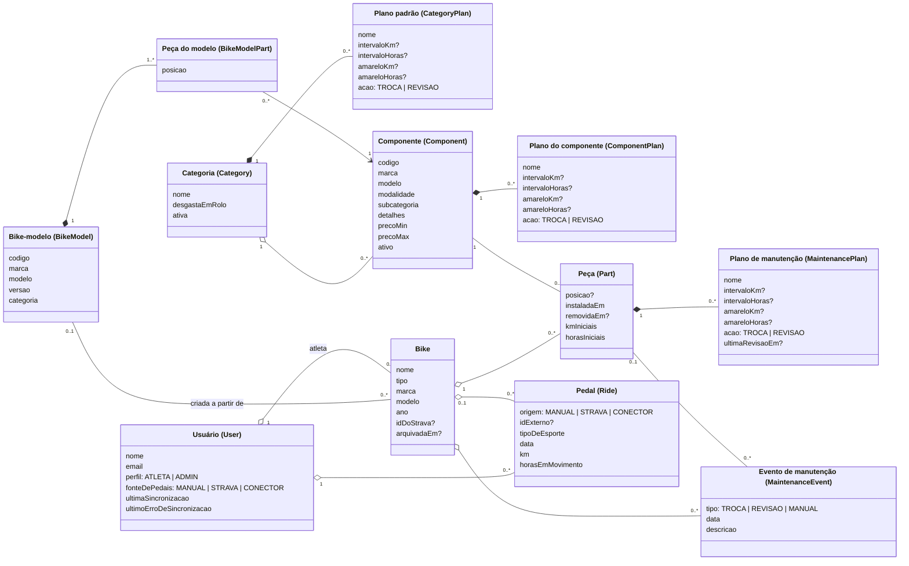

# Modelo de Domínio — GearLog (Fase 1)

Modelo conceitual do tracker de desgaste. Cobre só a Fase 1 (escopo da entrega). Os nomes entre parênteses são os nomes no código (`prisma/schema.prisma`).

## Diagrama

## Conceitos

| Conceito | Descrição | Regras |
|---|---|---|
| Categoria (família) | Família de peças do catálogo, como na planilha: Transmissão, Suspensão, Pneus, Freios, Rodas, Canotes e Selins. Mantida só pelo administrador. | RF30, RB10, RB14, RB15 |
| Plano padrão | Intervalo sugerido da família (em km, em horas ou nos dois) e a ação ao vencer. Vale para componentes sem plano próprio. | RF03, RB10, RB13 |
| Componente | Item do catálogo com código (ex.: `TRX-018`), marca, modelo, modalidade, subcategoria, detalhes e faixa de preço (ex.: Shimano Deore M6100). | RF30, RB15 |
| Plano do componente | Intervalo próprio do componente, vindo da planilha (ex.: corrente e cassete de um grupo; revisão básica e completa de um garfo). | RF02, RF03, RB16 |
| Bike-modelo | Bike de fábrica (aba Bikes da planilha) com as peças originais por posição. | RF35 |
| Bike | Bicicleta do atleta. Pode ser associada a uma bike do Strava/conector pelo `idDoStrava`. Arquivar não apaga. | RF01, RF05 |
| Peça | Um componente instalado numa bike numa data, numa posição (ex.: pneu traseiro). Encerra quando é trocada inteira (`removidaEm`). | RF02, RF10, RB01, RB05 |
| Plano de manutenção | Cópia do plano do componente (ou da família) na peça, editável pelo atleta. O desgaste e os alertas valem por plano; a troca de um item (ex.: corrente do grupo) zera só o plano dele. | RB16, RB18, RF07–RF09 |
| Pedal | Uma atividade de ciclismo, lançada à mão ou trazida da fonte do atleta. | RF06, RF14, RB02, RB03, RB12 |
| Evento de manutenção | Linha do histórico da bike: troca, revisão ou manutenção manual. | RF10–RF12 |

## Como o desgaste é calculado (RF06, RF07)

O uso de cada plano é **calculado a partir dos pedais guardados**, não somado num contador (ver [ADR-007](adr/ADR-007-desgaste-calculado-dos-pedais.md)):

1. Entram os pedais da bike da peça com data **a partir** do início do plano e **antes** da remoção da peça (RB02). O início do plano é a última revisão ou troca do item (RB13, RB18) ou, se nunca houve, a instalação da peça.
2. Pedais `VirtualRide` só entram se a categoria "desgasta em rolo" (RB14).
3. Se o plano nunca foi revisado, somam-se os km e as horas iniciais da peça.
4. Desgaste do plano = maior entre `km / intervaloKm` e `horas / intervaloHoras` (RF07, RB11).
5. Status: "troca/revisão próxima" (barra amarela) a partir do mínimo da faixa do catálogo (`amareloKm`/`amareloHoras`, ou 80% se o plano não tiver mínimo) (RF08, OPEN-17); de 100% "troca/revisão necessária" (RF09). O texto depende da ação do plano (RB04, RB13).
