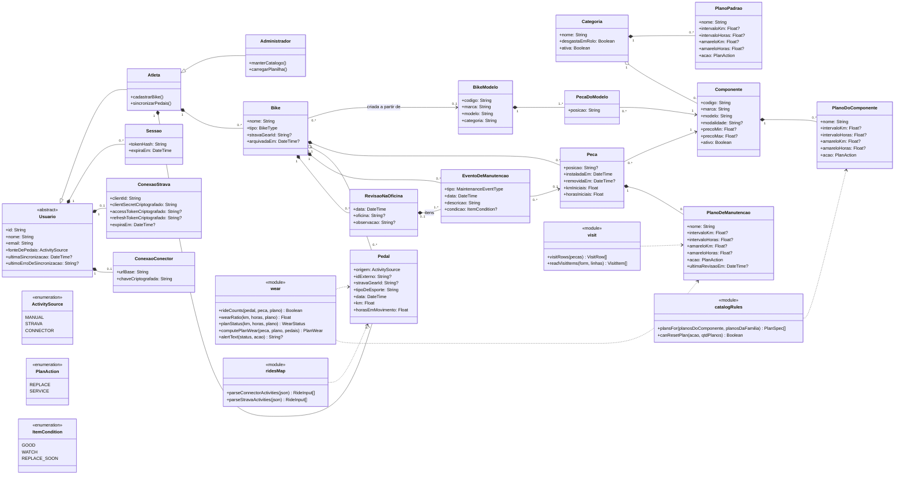
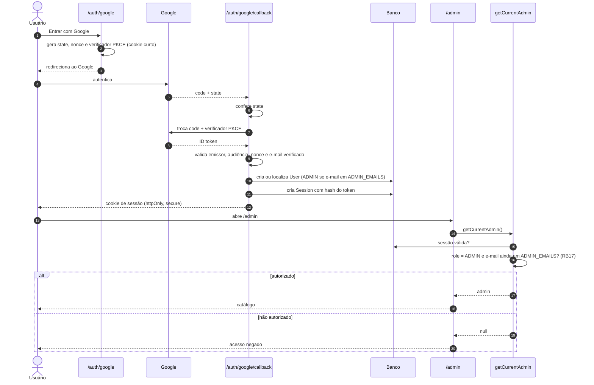

# Diagramas UML — GearLog (Fase 1)

Diagramas de classes e de sequência da Fase 1. O modelo conceitual de domínio está em [dominio.md](dominio.md), o diagrama de casos de uso em [casos-de-uso.md](casos-de-uso.md) e os termos no [glossário](glossario.md). Todos os diagramas são texto Mermaid versionado, conferido contra o código em 13/11/2026.

## 1. Diagrama de classes

O diagrama mostra as entidades persistidas (`prisma/schema.prisma`) e os módulos de regra pura (`src/lib/`). Os módulos são funções sem estado; aparecem como classes `«module»` para mostrar quem usa o quê.

- **Composição** (losango cheio): a parte não existe sem o todo e é apagada com ele. Exemplo: o plano de manutenção de uma peça.
- **Agregação** (losango vazio): o todo agrupa partes que têm vida própria. Exemplo: a bike agrupa pedais, mas um pedal importado pode ficar sem bike.
- **Herança:** Atleta e Administrador especializam Usuário. No banco, isso é o atributo `role`. O Administrador tem tudo o que o Atleta tem, mais o catálogo.



Invariantes que o diagrama não mostra sozinho:

- Uma peça pertence a uma só bike (RB01) e, depois de trocada, fica com `removidaEm` e não é apagada (RB05).
- Todo plano tem `intervaloKm` ou `intervaloHoras` (RB10). `amarelo*` é menor que o intervalo; sem ele, vale 80% (RB04).
- `idExterno` é único por atleta: sincronizar de novo atualiza o pedal em vez de duplicar (ADR-007).
- `stravaGearId` é único entre as bikes de um mesmo atleta (RF05).

## 2. Diagramas de sequência

### 2.1 Sincronizar pedais pelo conector, recalcular o desgaste e emitir alerta (UC06 + UC08)

O desgaste não é gravado: ele é recalculado a cada leitura a partir dos pedais guardados ([ADR-007](adr/ADR-007-desgaste-calculado-dos-pedais.md)). Por isso a sincronização só grava pedais, e o alerta nasce quando o painel é aberto.

```mermaid
sequenceDiagram
  autonumber
  actor A as Atleta
  participant P as Página Pedais
  participant S as syncNow (server action)
  participant R as syncRides (lib/rides/sync)
  participant C as Conector do atleta
  participant M as ridesMap
  participant DB as Banco (SQLite)
  participant D as Painel (loadDashboard)
  participant W as wear

  A->>P: clica em "Sincronizar agora"
  P->>S: syncNow()
  S->>S: requireUser()
  S->>R: syncRides(userId)
  R->>DB: lê fonte do atleta e conexão
  R->>C: GET /v1/gearlog/activities?since=1970-01-01 (Bearer chave)
  alt conector responde
    C-->>R: { activities: [...] }
    R->>M: parseConnectorActivities(json)
    M-->>R: pedais de ciclismo em km e horas (RB03, RB12)
    R->>DB: bikes do atleta com stravaGearId
    loop cada pedal
      R->>DB: upsert Ride por (userId, externalId), bikeId pelo gear
    end
    R->>DB: lastSyncAt = agora, lastSyncError = null
    R-->>S: { imported: n }
    S-->>A: redireciona: "n pedais sincronizados"
  else falha (rede, 401, resposta inesperada)
    C-->>R: erro
    R->>DB: lastSyncError = código (sem tokens no log)
    R-->>S: SyncError(código)
    S-->>A: redireciona com o erro; dados anteriores mantidos (RF13)
  end

  A->>D: abre o painel
  D->>DB: peças ativas, planos e pedais das bikes ativas
  loop cada plano de cada peça
    D->>W: computePlanWear(peça, plano, pedais)
    W->>W: rideCounts: pedal entre o início do plano e a remoção (RB02, RB14)
    W->>W: wearRatio: maior fração km/horas (RB11)
    W->>W: planStatus: amarelo no mínimo ou 80%, vermelho em 100% (RB04)
    W-->>D: { km, horas, ratio, status, alerta }
  end
  D-->>A: planos ordenados por desgaste, com "Troca próxima" ou "Troca necessária" (RF08, RF09, RF15)
```

### 2.2 Entrar com Google e acessar a área administrativa (UC01 + UC14)



### 2.3 Registrar revisão na oficina com vários itens (UC12)

Mostra a criação de objetos: a visita é criada primeiro e cada item cria um evento (e, numa troca inteira, uma peça nova).

```mermaid
sequenceDiagram
  autonumber
  actor A as Atleta
  participant B as Página da bike
  participant RV as recordShopVisit
  participant V as visit
  participant DB as Banco

  A->>B: preenche data, oficina e itens
  B->>RV: envia o formulário
  RV->>DB: peças instaladas com planos
  RV->>V: visitRows(peças)
  V-->>RV: linhas (plano a plano; peça sem plano)
  RV->>V: readVisitItems(form, linhas)
  V-->>RV: itens com ação e condição
  RV->>RV: valida data e se o plano pode ser zerado (RB13, RB18)
  RV->>DB: BEGIN
  RV->>DB: create ServiceVisit
  loop cada item
    alt peça inteira trocada
      RV->>DB: Part antiga.removedAt = data
      RV->>DB: create Part nova com os mesmos planos
      RV->>DB: create MaintenanceEvent(REPLACEMENT, condição)
    else revisado ou trocado (item)
      RV->>DB: MaintenancePlan.lastServiceAt = data
      RV->>DB: create MaintenanceEvent(SERVICE ou REPLACEMENT, condição)
    else verificado / item fora do catálogo
      RV->>DB: create MaintenanceEvent(MANUAL, condição)
    end
  end
  RV->>DB: COMMIT
  RV-->>A: "Revisão registrada"
```
